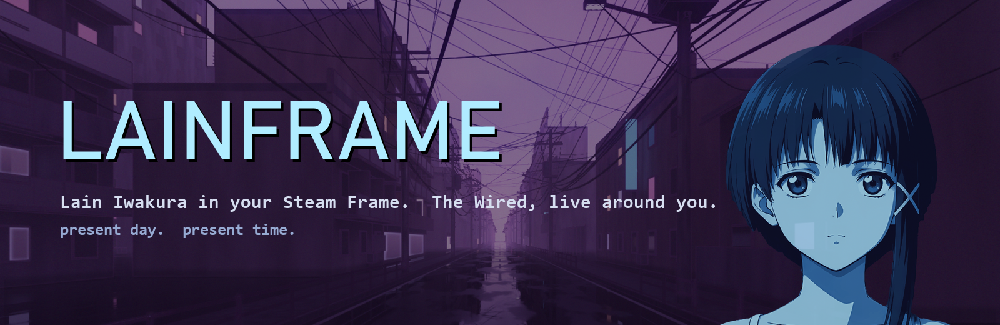
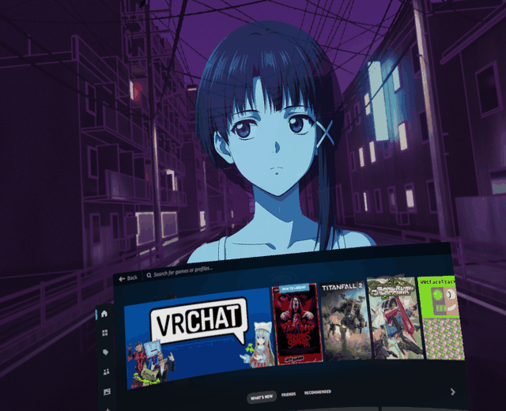
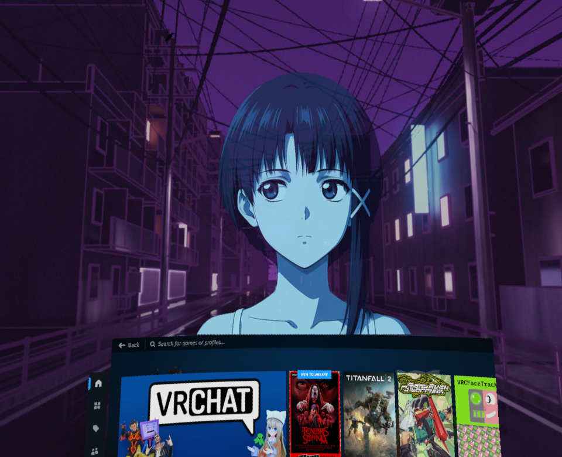
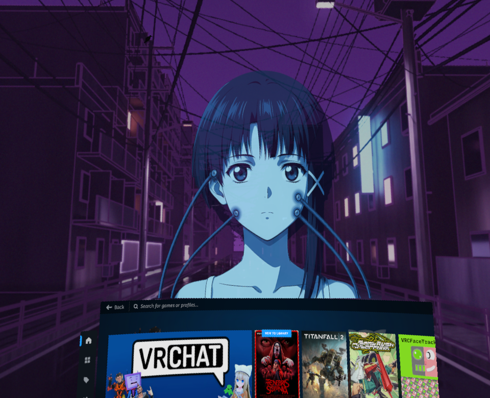
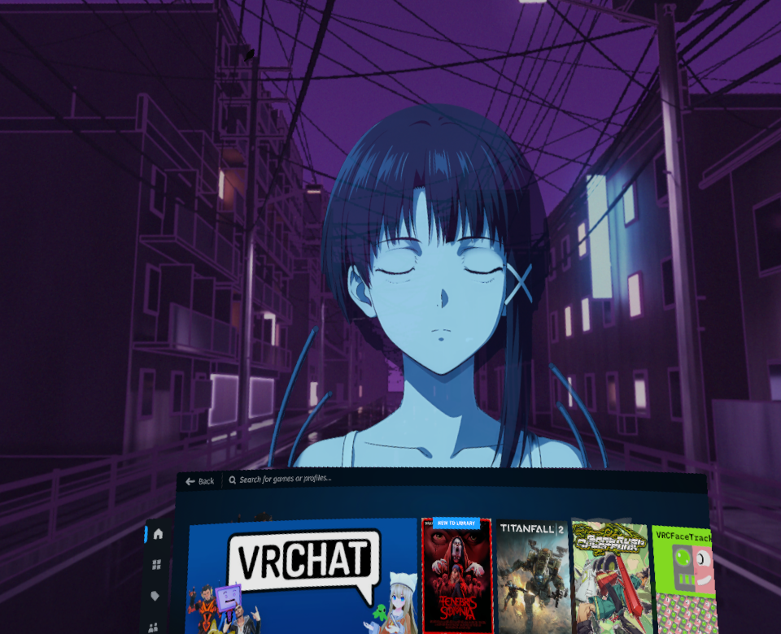
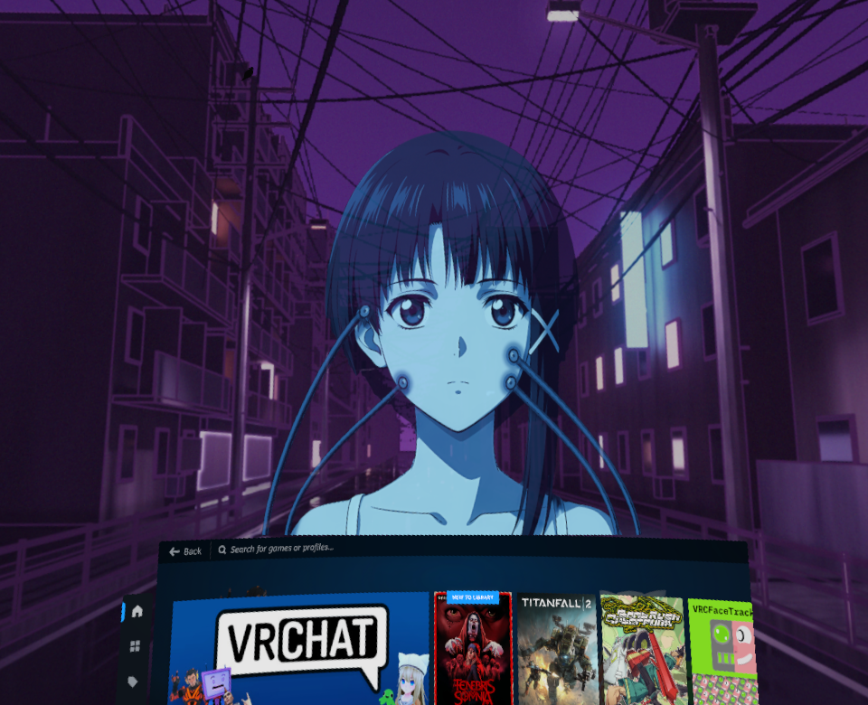
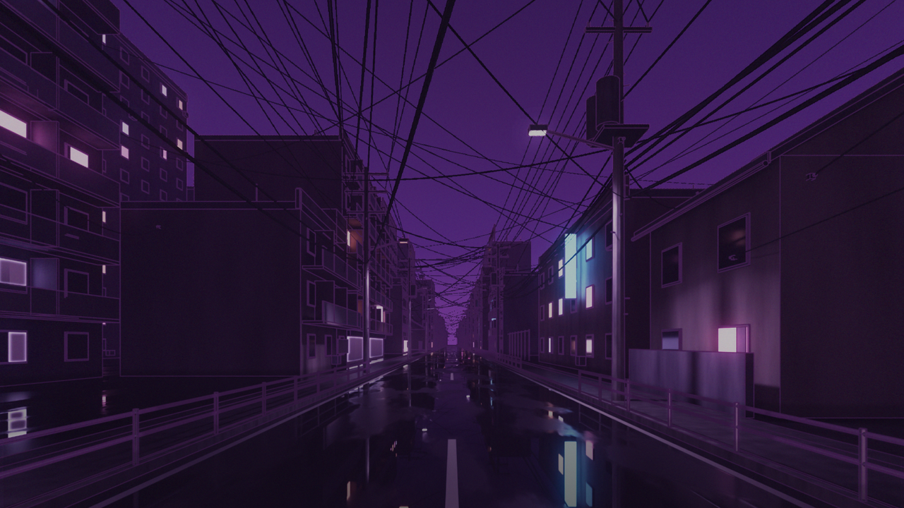
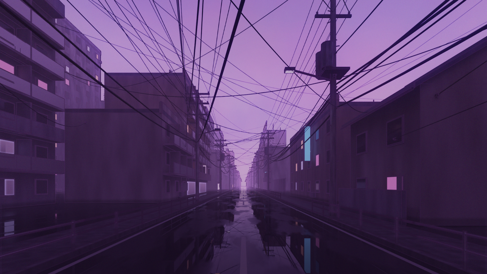
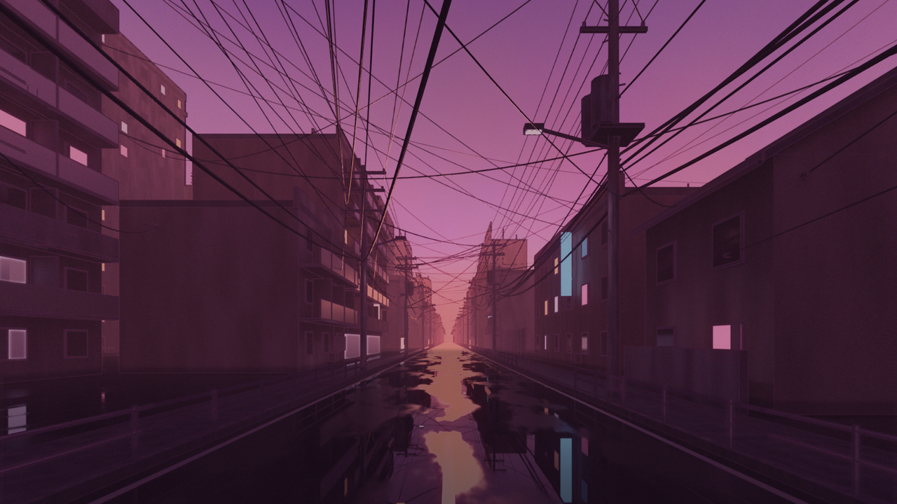

# Lainframe

*Present day. Present time.*

Lainframe puts **Lain Iwakura** in your **Steam Frame**. When you open the Steam menu while streaming from your PC,
she's already there, sitting quietly on top of the menu, half awake. Ask her something and she answers in a soft
voice with real lip sync. If the question takes a while, wires rise from behind the menu and clamp to her face while
she goes into the Wired to find the answer.

Around you is **The Wired**: a live skybox of a wet late-90s suburb street, humming power lines overhead, and a sky
that follows the real clock and the weather.

> An unofficial, non-commercial fan project. Not affiliated with the rights holders of *Serial Experiments Lain* or
> with Valve. See [ART_NOTICE.md](ART_NOTICE.md).

<i>Real captures from inside the Steam Frame (SteamVR screenshots), not renders.</i>

| | |
|---|---|
|  **Sitting on the Steam menu** |  **Wires rise from behind the menu while she works** |
|  **Connected, eyes closed** |  **Answering you, with lip sync** |

**The Wired**, one sky per time of day:

| Night | Dusk | Sunset |
|---|---|---|
|  |  |  |

---

## What it does

**Lain**
- Sits on the top edge of the Steam menu and follows it, including the curved home menu and other menus such as
  SteamVR settings.
- Is quietly alive: she breathes, looks around, dozes off, gets sleepier late at night and notices when you come back.
- Doesn't speak first. Click her with the laser, or say **"Wake up, Lain"** (optional). Her eyes find you and stay on
  you while you talk.
- Thinks with her eyes open. If the answer takes longer than about 15 seconds, the wires come in and she closes her
  eyes.
- Answers out loud with lip sync. Her brain is Claude, running through Claude Code on your PC.
- Only exists while you stream from your PC. In standalone mode she's completely off.

**The Wired** (skybox)
- Four moods follow your real clock: dawn and dusk, gloomy day, sunset and night, with slow 40-minute crossfades.
- Random weather: drizzle, rain, downpours, and random lightning that lights up the open sky behind the skyline (soft, never a strobe).
- Small signs of life: black cats running along the power lines, birds that cross the sky or land on a wire for a
  while, a puddle that shows something it shouldn't, and very rarely, red shadows.
- Gets out of the way: it hides while a game runs and in room view (passthrough), and the weather waits for you while
  it's hidden.

---

## Requirements

- **Steam Frame** on an up-to-date SteamOS with **Developer Mode** on and **SSH** enabled. The setup wizard walks you
  through both.
- **A Windows 10/11 PC** that can stream VR to the Frame with **Steam Link** (SteamVR installed). Any GPU that streams
  well works. The project was built on NVIDIA.
- About **8 GB of free disk** on the PC (art downloads plus the baked library), and a few GB free on the headset.
- The Frame and the PC on the same network (Wi-Fi, the Frame's wireless adapter, or USB).
- **Optional, for voice:** a [Claude Code](https://claude.com/claude-code) subscription, logged in on the PC. Without
  it, Lain and The Wired still run. She just won't talk.

- **Python 3.12 or newer** on the PC. If it's missing, `LainBrain.bat` tells you and opens the python.org download page
  (tick "Add python.exe to PATH" while installing). Everything else, it installs into its own private folder.

---

## Install

There's one way to install, and the wizard does the work:

1. **Download** this repository (green *Code* button, then *Download ZIP*, and unzip it) or `git clone` it.
2. **Double-click `LainBrain.bat`.**
3. **Follow the setup wizard.** It goes step by step, you can stop and resume it, and it's safe to run again:
   1. Checks your PC (Windows, disk space, Python environment).
   2. Gets the headset ready: Developer Mode, SSH, and a password for the `steamos` user. The wizard shows the exact
      steps. It never types or stores your password. For the one step that needs it, a window opens and **you** type
      it.
   3. Finds your headset on the network, makes an SSH key and checks that it works.
   4. Downloads the art (Lain's clips and the skies) from the release page and bakes it for the headset.
   5. Asks about the **opt-in extras** (see below). They all default to *no*.
   6. Deploys everything to the headset and checks the services.
   7. Optionally sets The Wired as your SteamVR background too.
   8. Optionally sets up voice: Claude Code login check, Whisper, Kokoro, what Lain should call you, and a test
      sentence played on your PC.
   9. Optionally starts Lain Brain when you log in.
   10. Runs a final health check. Every part shows green or red, with a fix for the red ones.

> ### Always start Lain Brain on your PC **before** you put the headset on.
> Double-click `LainBrain.bat` (or let autostart do it). It runs in the background. **Then** put the headset on and
> connect to your PC with **Steam Link**. Lain appears when you open the Steam menu.

---

## Opt-in extras

These are off unless you say yes in the wizard. Each one has its own service and can be removed on its own.

| Extra | What it does | What to know |
|---|---|---|
| **Boot guard** | After a SteamOS update or a hard power-off, the Steam UI can crash-loop and leave you on the Linux desktop. The guard watches the first 10 minutes after login. If the UI keeps crashing, it disables a known-bad Vulkan layer (colour mods that use vkBasalt), switches back to game mode, and logs what it did. | **It can restart SteamVR on its own**, and it renames a third-party layer file. The rename can be undone, and the log tells you how. |
| **Worn sensor / brightness** | Writes "worn / not worn" to a state file. With the brightness option on, it sets the screen to minimum when you take the headset off and maximum when you put it on. | It only acts on a change, so brightness you set by hand while wearing it stays. Some people won't want max brightness. |
| **Mic** | Holds the mic gain at a cleaner level (the Frame resets it louder every time the mic powers up) and adds an EQ (PipeWire filter-chain) to the mic stream that goes to your PC. | It changes what **every** PC app hears from your mic, not only Lain. It re-links the stream when you connect. |

---

## Performance

Numbers measured on the author's Frame. Yours may differ.

- **Lain:** about **1 ms per frame** to update her picture (an OpenGL texture handed straight to the compositor), with
  **zero memory growth** over time. She pauses when the menu is closed and is fully off in standalone mode.
- **The Wired:** about **5.4 ms of compositor GPU time** with flattened cube layers, down from 7.7 to 8.4 ms before
  flattening. That fits 120 Hz comfortably. At 144 Hz (6.9 ms budget) it's tighter.
- **Battery:** about **79% per hour** while streaming from the PC at 120 Hz. That's the cost of the headset
  streaming, not of Lainframe.

---

## Everyday use

| You want to... | Do this |
|---|---|
| Talk to her | Open the Steam menu, then click her with the laser (or say "Wake up, Lain"), then speak. She stops listening after a short silence. |
| Ask her to change things | With "let Lain change things" on (setup asks; recommended), ask out loud: "move a little to the left", "make the rain heavier", "be a bit more see-through". She edits it live on the headset while you watch, then tells you what she did. Destructive commands stay blocked. |
| Check that everything is healthy | `LainBrain.bat doctor` |
| Push an update to the headset | `LainBrain.bat deploy` |
| Change extras or voice | Run `LainBrain.bat` again. The wizard remembers what's done. |

---

## Uninstall

Run **`LainBrain.bat uninstall`**. It:
- runs `uninstall.sh` on the headset, which stops and removes every Lainframe service (extras included) and
  `~/lainframe`, and leaves nothing of ours behind;
- removes the autostart shortcut, and asks before deleting Lainframe's settings, Lain's memory and the art from your PC.

If you set The Wired as your SteamVR background, uninstall puts your previous background back. After that, delete the folder.

---

## FAQ

**Is this official?**
No. It's a fan project with no connection to the rights holders of Serial Experiments Lain or to Valve. It's free and
not for sale. See [ART_NOTICE.md](ART_NOTICE.md).

**Why does Lain only appear while I'm streaming from my PC?**
Her voice, her brain and the setup tooling live on the PC. Without the PC stream she'd be a silent picture eating
battery. In standalone mode she switches herself off completely. The Wired skybox works in both modes.

**Does it work in games?**
The skybox hides itself while a game runs (standalone or PC) and comes back when you leave. Lain lives on the Steam
menu, so you'll see her whenever you open the menu, in a game or not.

**Privacy: what leaves my machine?**
Nothing, until you talk to her. When you do, your recording is transcribed **on your PC** (Whisper). The text then
goes to **Anthropic** through **your own Claude Code login** to make her answer, and her voice is synthesized **on your
PC** (Kokoro). The optional wake phrase listener only opens the mic while the menu is open and she's idle, and it's
processed locally. Lainframe has no telemetry and no servers.

**Will a SteamOS update break it?**
Everything lives in your home folder, so updates don't wipe it. Updates can still change SteamVR behaviour. If the
Steam UI crash-loops after an update, see [docs/TROUBLESHOOTING.md](docs/TROUBLESHOOTING.md).

**Can I change her voice or what she calls me?**
Yes. Run the wizard again (voice step).

---

## More

- [docs/HOW_IT_WORKS.md](docs/HOW_IT_WORKS.md): the engineering (the SteamVR overlay leak, curved-menu fitting, lip
  sync, sky performance).
- [docs/TROUBLESHOOTING.md](docs/TROUBLESHOOTING.md): fixes for the common problems.
- [CREDITS.md](CREDITS.md) · [CHANGELOG.md](CHANGELOG.md) · [LICENSE](LICENSE) (MIT, code only) ·
  [ART_NOTICE.md](ART_NOTICE.md)

*No matter where you go, everyone's connected.*
